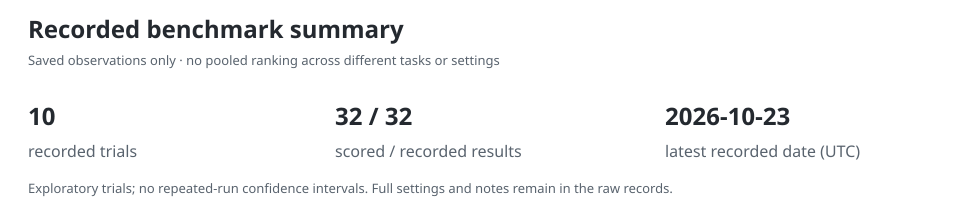
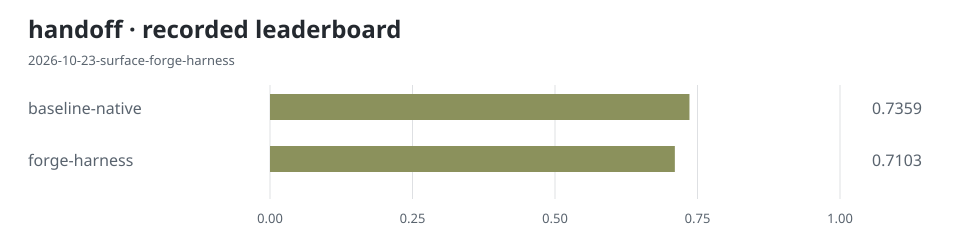
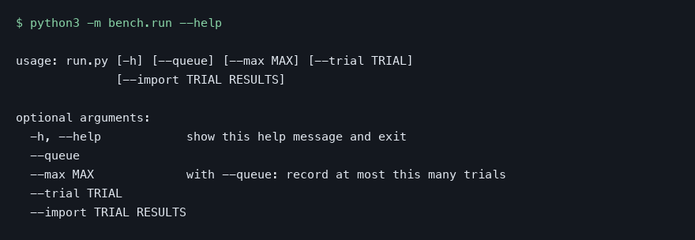

# bencharness

Compare agent harnesses on the same tasks, model, memory, and time budget.

## Install

```sh
pipx install bencharness
```

Or use uv:

```sh
uv tool install bencharness
```

A user-local curl installer:

```sh
curl -fsSL https://raw.githubusercontent.com/ogarciarevett/bencharness/main/install.sh | sh
```

Homebrew:

```sh
brew tap ogarciarevett/bencharness https://github.com/ogarciarevett/bencharness && brew install ogarciarevett/bencharness/bencharness
```

## Verify

```sh
bench --help
```

Python 3.9 or newer is required. The first PyPI release awaits the owner's
[publication step](docs/releasing.md); PyPI and the default curl install become
available after publication. Homebrew installs the pinned source distribution.
Installing or invoking `bench` without arguments starts no benchmark.
`bench --report --workspace PATH` renders saved data without a source checkout.
Trial commands use `bench --workspace PATH --trial trials/ID.json`, where PATH
is the source checkout with the pinned assets described below.

<!-- charts:start -->




The featured task is the most recent recorded comparison with a score spread; ties appear in the full gallery. If every comparison ties, the latest task is shown. Each chart retains its own experiment scope.

[All task leaderboards, harness trends and older runs](docs/charts/README.md) · [Raw records](results/trials.jsonl)
<!-- charts:end -->



*Actual output of `python3 -m bench.run --help`; no model call is made.*

## From source

Clone the repository. The Python runner uses only the standard library; Python 3.12
is recommended. Reporting works without a model account or external checkouts.

```sh
git clone https://github.com/ogarciarevett/bencharness.git && cd bencharness
```

```sh
python3 -m bench.run --help  # inspect the CLI shown above
python3 -m bench.report     # regenerate chart images and the results appendix offline
head -n 10 RESULTS.md       # inspect the recorded harness2 comparison
```

This displays saved measurements. It does not rerun a benchmark. Executing trials
requires macOS, the configured subscription runtime, and pinned external assets;
see [Running trials](#running-trials).

## What it measures

- Each trial fixes the task suite, harness revisions, model settings, memory backend,
  and active time budget so the recorded comparison has an explicit scope.
- Sealed checks stay outside the candidate workspace. Visible checks let an agent
  test its implementation without exposing the scoring set.
- Records keep scores alongside active seconds, model-call counts, and estimated
  model costs. A tie in score can still have a different runtime or cost.
- Reports regenerate from [results/trials.jsonl](results/trials.jsonl), without
  calling a model. Trial errors and host pauses are separate from completed scores.

## One harness2 trial

On our tasks, in one trial, Google's [harness2](https://github.com/google-research/harness2)
tied our baseline harness on both saved-retrieval tasks:

| Task | Score, both harnesses | Active seconds, baseline / harness2 | Model calls, baseline / harness2 | Estimated USD, baseline / harness2 |
| --- | --- | --- | --- | --- |
| handoff | 0.7359 | 75.2 / 793.1 | 1 / 10 | 0.0814 / 0.8701 |
| engineering | 0.7949 | 94.7 / 503.6 | 1 / 7 | 0.1142 / 0.9102 |

These are **one trial, 13 sealed items per task, on our own tasks**. All final
plugins reached the retrieval ceiling, and compose was a no-op on both tasks.
The tie therefore shows **no harness effect either way**. Runtime was about 10.6x
and 5.3x higher; estimated model cost was about 10.7x and 8.0x higher, respectively.
Both scores were below the trial's pass threshold. This does not establish how
harness2 performs on other tasks or at other settings.

The full chart gallery below includes other exploratory trials. Those records are
separate experiments, not repetitions of the harness2 comparison.

## How a trial works

1. A JSON specification in [trials/](trials/) names the suite, tasks, harnesses,
   source revisions, model, reasoning effort, memory backend, and time budget.
2. `bench.checks` validates the specification and candidate licence. Host admission
   and a trial lock determine whether execution can start. A host pause preserves
   the remaining active budget instead of creating a completed score.
3. The runner prepares pinned candidate sources and invokes an adapter from
   [harnesses/](harnesses/). Text-surface adapters add rules or skills to a common
   base loop; they do not install the candidate's own CLI, servers, or hooks.
4. A trusted scorer checks the output against sealed items. The runner stores the
   result and its settings; `bench.report` generates the tables in this file and
   [RESULTS.md](RESULTS.md).

The saved-retrieval suite measures handoff and engineering against fixed retrieval
inputs. The synthetic rules suite covers ledger events, layered configuration,
querying, recurrence, and a spreadsheet engine. Each item includes its evidence.
The desktop suite stages a multi-file Tauri 2 / Rust / React work queue and uses
22 sealed headless checks, including Tauri MockRuntime IPC. It creates no native
window and provides no packaging or device acceptance.

## Running trials

The report and unit tests use the Python standard library. Trial execution is
macOS-specific and fails closed without its sandbox or pinned assets. The pinned
pilot adapters require `BENCH_PILOT` (a compatible pilot directory containing
`round2.py`, its virtual environment and pinned harness checkouts) and
`BENCH_HYPERAG` (the compatible retrieval evaluation checkout). These external
assets are not distributed here, so cloning this repo alone cannot reproduce the
historical model runs. The desktop comparison also requires staged offline
Rust/Node dependencies, the pinned executor, and matching fingerprints.
Set `BENCHARNESS_BUILD_LOCK` to the shared build lock when coordinating local
workers; its default is `.cache/local-ci-build.lock` inside this repository.

```sh
python3 -m unittest discover -s tests -v                    # local tests
python3 -m bench.run --trial trials/<id>.json               # configured model run
python3 -m bench.run --queue                               # pending configured trials
python3 -m bench.run --import trials/<id>.json results.json # import existing pilot output
```

Executing a trial can consume subscription usage. Fixed checks currently accept
only the configured model and standard subscription tier; paid-API trials and new
accounts are escalated. Model names in trial records describe the evaluated
runtime. Estimated model cost is a measurement, not an invoice or a claim that
those API charges were paid.

For a text adapter, declare `APPEND` (files appended to AGENTS.md) and `COPY`
(candidate directories copied into the workspace), as in
[harnesses/forge_harness.py](harnesses/forge_harness.py). Add a reviewed adapter,
a pinned specification, and an admitted candidate record. Adapters must refuse
settings they cannot honour.

## Execution boundaries

The shared model seam runs one call at a time with a fixed active budget.
`schedule/codex-safe` starts the subscription runtime with a temporary configuration
home, an empty extension allow list, and plugins, connected apps, hooks, browser
and computer tools, and delegation disabled. Command networking and device access
are denied. An inventory or policy failure refuses startup.

Untrusted adapters execute in a separate leaf sandbox with a restricted environment,
workspace writes only, and no home-directory reads. Submitted desktop programs
run without process creation; trusted compilation separately permits child
processes. Cleanup covers the original process group and observable descendants,
not arbitrary detached sessions. Trusted compilers must not daemonize.

The app broker pins the model, effort, workspace and command policy, requires
server confirmation, and keeps authentication and protected receipts outside the
candidate sandbox. Desktop comparisons use the candidate's pinned executor,
not its full server. Standard tier is requested; the current CLI may omit an
unsupported tier, so desktop results must disclose that limitation.

Host admission checks load, swap, free memory and known heavy runners. It is
host-specific and is not a general scheduler or a guarantee that unrelated jobs
are absent. Model and desktop compilation work must be serialized on the host.

## Optional scheduling

[schedule/](schedule/) contains nightly candidate discovery and trial scripts,
a reporting hook, and a morning review script. Installation is opt-in via
`schedule/install.sh`; the quick start installs no background jobs. Configure
external assets and `BENCH_REPORT_TO` before installing on macOS. Nightly runs
open a PR; the morning script checks stored evidence, requests a separate
read-only review, and merges only when its checks and exact-head CI succeed.

## Results

<!-- results:start -->
[Browse chart images and older runs](docs/charts/README.md). Raw tables and trial notes are in [the results appendix](RESULTS.md).
<!-- results:end -->

Trial notes and provenance are in [RESULTS.md](RESULTS.md).

## Limits and pending work

- The harness2 result is one trial with small sealed sets and a retrieval ceiling.
  There are no repeated-run confidence intervals or broad superiority claims.
- Several synthetic rules tasks saturate at 1.0 for baseline and candidates.
  Harder tasks or calibration may separate them; a queued trial is not evidence.
- Text-surface trials measure added instructions, not a candidate's complete runtime.
- Historical specifications pin old suite revisions. The renamed desktop suite
  needs a new reviewed suite pin and staged dependency metadata before a new run;
  admission refuses mismatched inputs. No desktop result is reported here.
- External pilot code, retrieval assets and offline dependencies are required for
  model runs. This repo provides the runner, specifications and saved measurements,
  not a standalone reproduction bundle.
- Sandbox and host tests provide bounded evidence. They do not prove production,
  native packaging, device, or financial readiness.

## License

[Apache License 2.0](LICENSE).
