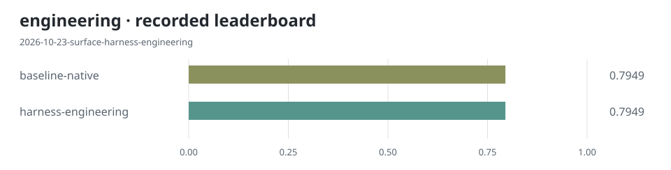
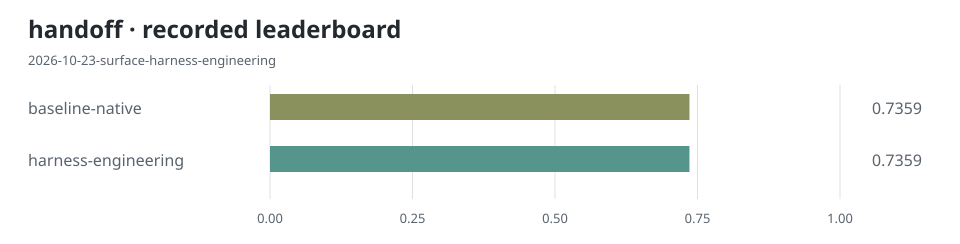
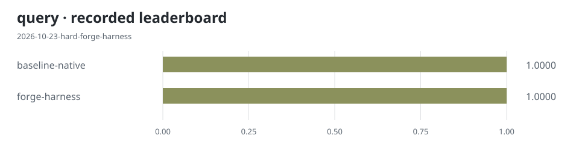
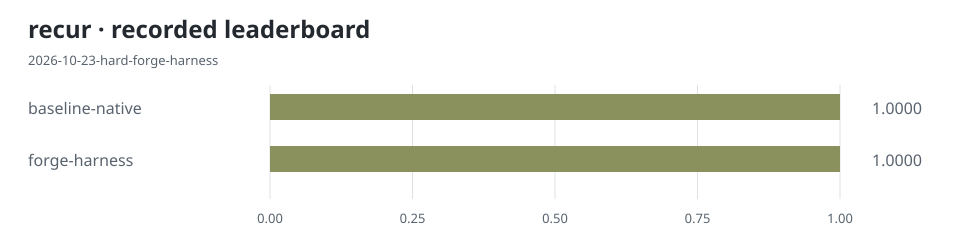
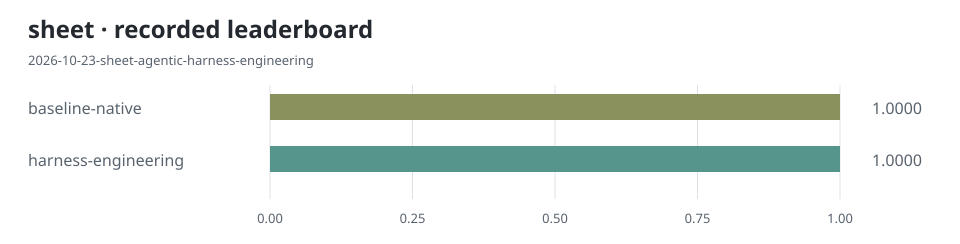
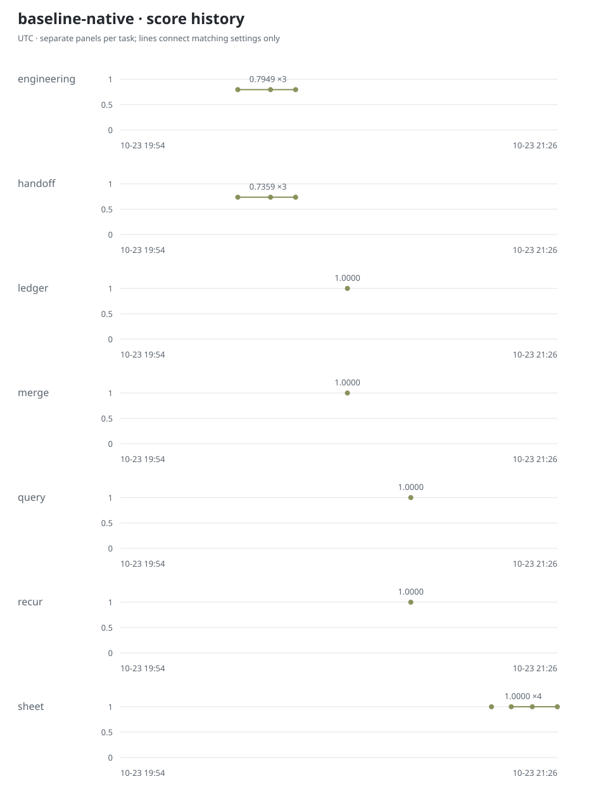
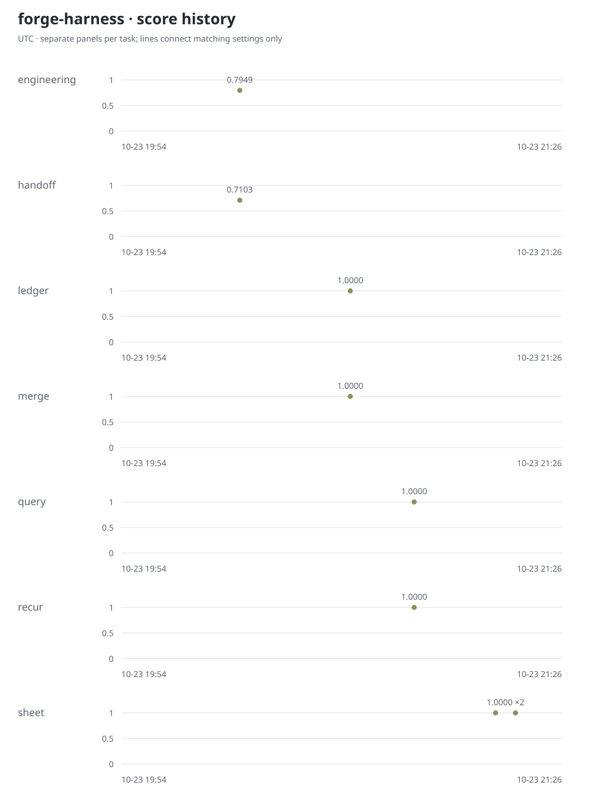
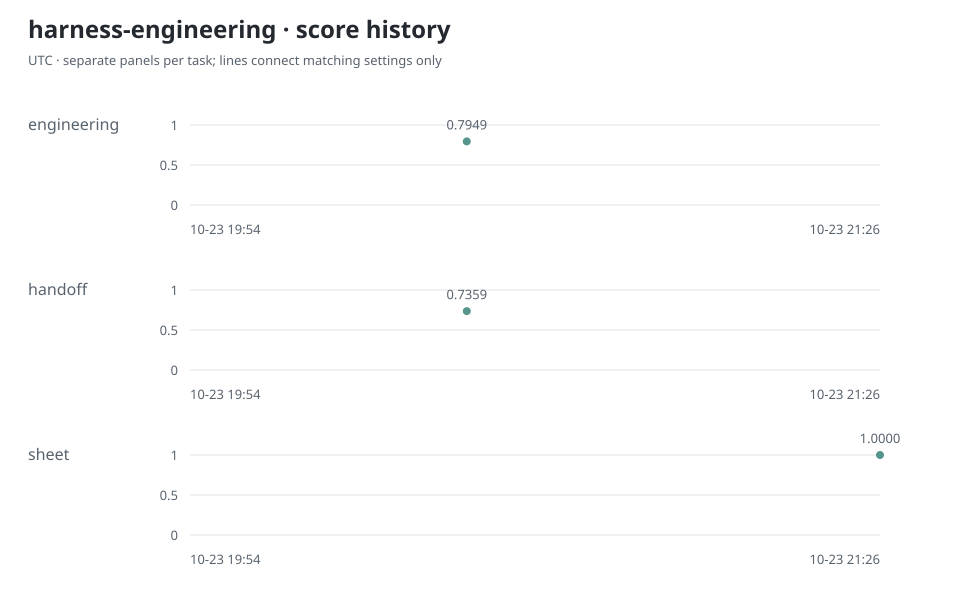
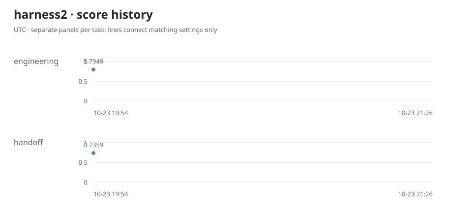
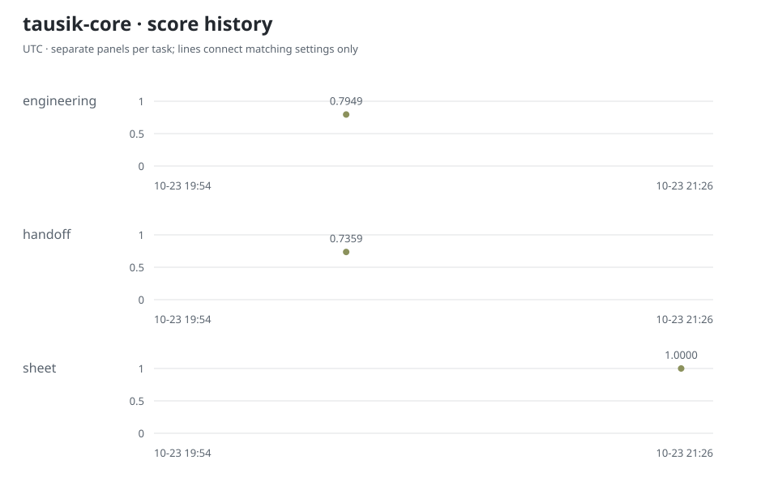

# Recorded charts

Each leaderboard uses the latest recorded trial containing that task; different charts can describe different experiments.

## Older runs

- [2026-10-23-sheet-agentic-harness-engineering](runs/2026-10-23-sheet-agentic-harness-engineering-549832cd/README.md)
- [2026-10-23-sheet-agentic-tausik-core](runs/2026-10-23-sheet-agentic-tausik-core-bc0ab792/README.md)
- [2026-10-23-sheet-agentic-forge-harness](runs/2026-10-23-sheet-agentic-forge-harness-3f762f02/README.md)
- [2026-10-23-sheet-one-shot-forge-harness](runs/2026-10-23-sheet-one-shot-forge-harness-e006696c/README.md)
- [2026-10-23-hard-forge-harness](runs/2026-10-23-hard-forge-harness-fe7aaf67/README.md)
- [2026-10-23-rules-forge-harness](runs/2026-10-23-rules-forge-harness-4e2cdc48/README.md)
- [2026-10-23-surface-harness-engineering](runs/2026-10-23-surface-harness-engineering-a08629e3/README.md)
- [2026-10-23-surface-tausik-core](runs/2026-10-23-surface-tausik-core-90c22495/README.md)
- [2026-10-23-surface-forge-harness](runs/2026-10-23-surface-forge-harness-c8e93e92/README.md)
- [2026-10-23-hyperag-harness2-arm](runs/2026-10-23-hyperag-harness2-arm-e4f98033/README.md)

[Raw records](../../results/trials.jsonl) · [Tables and notes](../../RESULTS.md)
